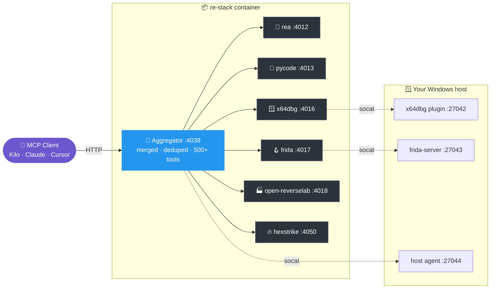

<div align="center">

# 🧬 RE-Stack

### One container. One endpoint. A complete reverse-engineering workbench.

**500+ tools** from **6 upstream MCP servers**, fused into a single deduplicated catalog — plus an **in-container Windows bridge** for live debugging.

<br>

[](#-quick-start)
[](#-connect-your-mcp-client)
[](#-quick-start)
[](#-tool-catalog)
[](LICENSE)

<br>

```bash
docker compose up -d --build     #  →  http://127.0.0.1:4038/mcp
```

</div>

---

## 🧰 What is RE-Stack?

RE-Stack bundles the open-source **reverse-engineering MCP ecosystem** behind **one HTTP endpoint**, so a single MCP client can drive everything — static analysis, decompilation, dynamic instrumentation, native debugging, fuzzing, and offline offensive tooling.

It's an **aggregator**: each upstream server runs as a supervised process **inside one container**, and a thin aggregator merges their tools into **one clean, duplicate-free catalog**.

> 💡 No more juggling six MCP servers in your client. Point it at **one URL**.

---

## ✨ Why you'll like it

| | Feature | What it means |
|---|---|---|
| 🎯 | **One endpoint, one catalog** | 6 servers → 1 URL, collisions auto-resolved |
| 🧱 | **Static RE — any binary** | PE/DLL/EXE · ELF · Mach-O · .NET · firmware · wasm · APK |
| 🩺 | **Dynamic analysis** | Frida hooks/traces · native debugging (gdb, x64dbg) |
| 🪟 | **Windows bridge** | Debug & instrument software **on your Windows host**, from the container |
| 💥 | **Offline offensive** | Payload gen · john/hashcat · AFL++ · pwntools · angr · ROP |
| 📦 | **Portable** | Builds from public sources; one `docker compose up` |
| 🎛️ | **Config-driven** | Add/remove any tool by editing one JSON — no rebuild |

---

## 🏗️ Architecture



---

## ⚡ Quick Start

**Requirements:** Docker + Docker Compose v2

```bash
git clone https://github.com/Akshat-530/re-stack-mcp.git
cd re-stack-mcp
docker compose up -d --build          # first build ~1.5 GB, 5–10 min ⏳
```

**✅ Verify**

```bash
docker exec re-stack supervisorctl status          # 11 programs RUNNING
curl -s -X POST http://127.0.0.1:4038/mcp \
  -H 'content-type: application/json' \
  -d '{"jsonrpc":"2.0","id":1,"method":"tools/list"}'
```

> 📁 Drop target binaries into **`./samples/`** — they appear at `/work` and inside the open-reverselab sandbox.

---

## 🔌 Connect your MCP client

RE-Stack is a **streamable-HTTP MCP server** at `http://127.0.0.1:4038/mcp`.

<details open>
<summary><b>🟣 Kilo / Kilo Code</b></summary>

```jsonc
{
  "mcp": {
    "re-stack-mcp": {
      "type": "remote",
      "url": "http://127.0.0.1:4038/mcp",
      "enabled": true,
      "timeout": 1800000
    }
  }
}
```
</details>

<details>
<summary><b>🟠 Claude Desktop</b> (stdio↔http proxy)</summary>

```json
{
  "mcpServers": {
    "re-stack": { "command": "npx", "args": ["-y", "mcp-remote", "http://127.0.0.1:4038/mcp"] }
  }
}
```
</details>

<details>
<summary><b>⚫ Cursor · Cline · Continue · OpenCode · any client</b></summary>

Same idea — a **remote HTTP MCP server** at that URL, or `mcp-remote` for stdio-only clients.
</details>

> 🔒 The container publishes **only** `127.0.0.1:4038` — never exposed beyond your machine.

---

## ⚙️ Configuration

Everything exposed lives in **`data/re-stack/config/config.json`** (mounted live at `/data/config/config.json`):

```jsonc
{
  "server": { "name": "RE-Stack", "helperPrefix": "re_stack" },
  "upstreams": [
    {
      "name": "hexstrike",
      "url": "http://127.0.0.1:4050/mcp",
      "prefix": "",                                  // "" keeps original names
      "include": ["binwalk_analyze", "john_crack"],  // [] = all tools
      "exclude": [],                                 // deny-list
      "enabled": true
    }
  ]
}
```

**Apply without a rebuild** 🔁

```bash
docker compose restart re-stack      # then reconnect the MCP client
```

| Field | Effect |
|---|---|
| `include` | allow-list of original tool names (`[]` = everything) |
| `exclude` | deny-list |
| `prefix` | `""` keeps names; collisions auto-rename `<label>__<tool>` |
| `enabled` | disable a whole upstream |

---

## 🪟 Windows Bridge

> **Static RE needs no bridge.** Mount a drive and read `/host/c/...` directly:
> ```yaml
> volumes:
>   - "C:\\:/host/c"
> ```

For **dynamic** work (run it, watch it, hook it, execute in it) the container reaches three Windows-side services through `socat` relays.

### 1️⃣ Copy the bridge
Copy **`bridge/Bridge.bat`** + **`bridge/host_agent.ps1`** into one folder (e.g. `C:\re-bridge\`). x64dbg should be at `C:\x64dbg\release\` *(edit the path at the top of `Bridge.bat` if not)*.

### 2️⃣ Launch

```cmd
Bridge.bat start         :: x64dbg + frida-server + host agent
Bridge.bat start x32     :: also launch x32dbg
Bridge.bat status        :: ports + agent health
Bridge.bat stop          :: stop everything
```

*First run auto-downloads `frida-server` into the bridge folder.* 🪄

| 🧩 Windows service | 🔌 Port | 🎁 Gives the container |
|---|---|---|
| **x64dbg** (MCP plugin) | `27042` | run / step / breakpoint / patch a Windows EXE/DLL |
| **frida-server** | `27043` | hook & instrument any running Windows process |
| **host agent** | `27044` | list processes · list loaded DLLs · launch a program · run a command |

### 3️⃣ Use it

- 🪟 **Debug** → `x64dbg_debug`, `x64dbg_registers`, `x64dbg_memory`, `x64dbg_breakpoints` ...
- 🔎 **Runtime RE** → `execute_command`: `curl "http://127.0.0.1:27044/processes"`, `.../modules?pid=NNN`, `.../run?path=C:\app.exe`, `.../exec?cmd=...`
- 🪝 **Frida** → `frida -H 127.0.0.1:27043 -n app.exe -l hook.js`

> ⚠️ **Security:** the host agent's `/exec` runs commands on your Windows box. It's **localhost-only**, reachable only via the container relay. Keep the bridge on a machine you control and target only systems you're **authorized** to test.

🐧🍎 **Linux/macOS hosts:** the bridge is Windows-specific — run frida-server natively there; all upstreams are OS-agnostic.

---

## 🎯 Usage examples

```text
🧱 Static triage of a Windows DLL
   rea.open_binary            { "path": "/host/c/Windows/System32/kernel32.dll" }
   reverselab.triage_pe       { "path": "/work/malware.exe" }
   hexstrike.checksec_analyze { "binary": "/host/c/Windows/System32/kernel32.dll" }

🩺 Dynamic (bridge running)
   x64dbg.x64dbg_debug        { "action": { "action": "run" } }
   frida.enumerate_devices    {}
   execute_command            { "command": "frida-ps -H 127.0.0.1:27043 | head" }

💥 Offline offensive
   execute_command            { "command": "afl-fuzz -i in -o out -- ./target @@" }
```

---

## 🧪 Tool Catalog

| 🧬 Upstream | 🔌 Port | 🧮 Tools | 🎯 Role |
|---|---:|---:|---|
| **rea** | 4012 | **259** | AI-assisted RE + decompile orchestration — static / dynamic / mobile / macOS / .NET / wasm / firmware / pcap |
| **open-reverselab** | 4018 | **127** | Ghidra headless · rizin/Cutter · DiE · PE patching · adb+frida · YARA/Sigma · CTF |
| **frida** | 4017 | **41** | Runtime instrumentation & hooking |
| **x64dbg** | 4016 | **23** | Windows EXE/DLL debugging *(via the bridge)* |
| **pycode** | 4013 | **14** | Python code intelligence |
| **hexstrike** | 4050 | **43** | Offline offensive + forensic subset |
| **local** | — | **3** | `re_stack_status` · `re_stack_refresh` · `re_stack_rotation` |
| **Σ TOTAL** | | **510** | 🎉 zero duplicates |

> 🏷️ Names are **unprefixed**; rare collisions auto-rename `<label>__<tool>`. Fully editable in `config.json`.

---

## 🔥 Capability Matrix

| Capability | Covered by | Status |
|---|---|:---:|
| Peek inside any PE / DLL / EXE | rea · reverselab · hexstrike | ✅ |
| ELF / Mach-O / firmware / wasm / .NET / APK | rea | ✅ |
| Decompile to pseudo-C | rea · Ghidra (reverselab) | ✅ |
| Runtime hooks & tracing | frida · rea | ✅ |
| Native debugging | gdb · rizin · **x64dbg** (Win) | ✅ |
| ROP / exploit dev | ropper · ROPgadget · one_gadget · pwntools · angr | ✅ |
| Symbolic execution | angr | ✅ |
| Fuzzing | AFL++ *(via `execute_command`)* | ✅ |
| Password cracking (offline) | john · hashcat | ✅ |
| PE hardening report | `checksec_analyze` (PE wrapper) | ✅ |
| Memory forensics | volatility3 · foremost | ✅ |
| Android / adb | rea · reverselab | ✅ *(after optional tools)* |
| Network-scanning / exploitation | — | ⛔ *by design (edit `include`)* |

---

## 🔌 Ports & Mounts

| 🔌 Port | ↔️ Direction | 🎯 Purpose |
|---|---|---|
| `4038` | published → host | the single MCP endpoint |
| `4012–4050` | internal | upstream MCP servers |
| `27042–27044` | internal relays | Windows bridge → `host.docker.internal` |

| 📁 Mount | 🎯 Purpose |
|---|---|
| `./data/re-stack:/data` | aggregator config |
| `./samples:/work` | your targets |
| `./samples:/opt/open-reverselab/samples` | same files, inside the reverselab sandbox |
| `C:\:/host/c` *(optional)* | read host drives directly |

---

## 📦 Optional Heavyweight Tools

The base image is deliberately lean. Enable **Ghidra · JDK · rizin/Cutter · Android platform-tools**:

```bash
docker exec re-stack sh /opt/install-optional-tools.sh
docker compose restart re-stack
```

> 🔄 The installer resolves the **latest** release URLs from the GitHub API — it never goes stale.

---

## 🛠️ Troubleshooting

| 🤒 Symptom | 💊 Fix |
|---|---|
| `x64dbg ... plugin did not come online` | start x64dbg on the host → `Bridge.bat start` (alive = `curl -s -o NUL -w "%{http_code}" http://127.0.0.1:27042/` → `404`) |
| frida can't see Windows processes | frida-server must listen on `27043` → test `frida-ps -H 127.0.0.1:27043` |
| Ghidra / `ghidra_headless_analyze` fails | run `/opt/install-optional-tools.sh` |
| `rz-bin not found` | install rizin via `/opt/install-optional-tools.sh` |
| Tool list looks stale | connector caches `tools/list` → `docker compose restart re-stack`, reconnect |
| Only 3 tools exposed | `WEBSTACK_CONFIG` isn't pointing at the mounted config |

---

## ⚖️ Legal & Authorized Use

> 🚦 RE-Stack is for **security research, malware analysis, interoperability, and authorized testing only.** You must have explicit permission for every target you analyse or instrument. The offline offensive tools and the Windows host agent (`/exec`) are powerful — use them only on systems you own or are contracted to assess.

---

## 🙌 Credits

| Project | Purpose |
|---|---|
| [rea-agents](https://www.npmjs.com/package/rea-agents) | AI-assisted RE + decompile orchestration |
| [open-reverselab](https://github.com/LING71671/open-reverselab) | Ghidra / rizin / adb tooling |
| [frida](https://frida.re) | Runtime instrumentation |
| [x64dbg](https://x64dbg.com) | Windows debugger |
| [HexStrike AI](https://github.com/0x4m4/hexstrike-ai) | Offensive / forensic tools |
| [Ghidra](https://ghidra-sre.org) · [rizin](https://rizin.re) · [pwntools](https://pwntools.com) · [pycode-mcp](https://github.com/spkc83/pycode-mcp-server) | analysis engines |

<div align="center">

## 📜 License

**MIT** — see [LICENSE](LICENSE)

<br>

⭐ **If RE-Stack is useful, star the repo!**

</div>
